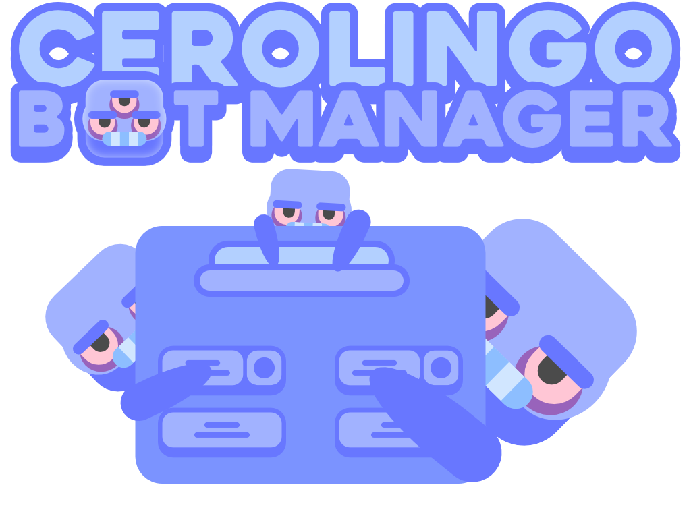

# Cerolingo Bot Manager


[](https://ancymon.dev/Cerolingo-Bot-Manager/)

Desktop application for creating and managing Duolingo bot accounts, farming XP, and running the Cerolingo auto-solver with Playwright.



## Features

- **Account Creator**: Automatically registers new Duolingo accounts using Playwright with customizable username prefixes, email domains, and optional leaderboard qualification (10 lessons).
- **XP Farming**: Farms XP on every saved account in `accounts.txt`. **Legit** mode logs into each account, solves real lessons on duolingo.com/lesson with the Cerolingo mod menu and tracks lessons and XP gained; with Legit off it uses the faster practice-session API.
- **Auto Solver**: Logs in with a saved account (or lets you log in yourself), opens duolingo.com/lesson and solves the number of lessons you choose (0 = until you close the window) using the Cerolingo mod menu, which is downloaded from the [Cerolingo repository](https://github.com/ancym0n/Cerolingo) on every run.
- **Account Manager**: Quickly opens and manages your saved `email:password:cookie` account list.
- **Hidden mode**: Every activity that opens a browser has a **Hidden** toggle to run it in the background.
- **Updates**: Offers new releases from GitHub when they come out (never forced).
- **Cross-Platform**: Runs on both Windows and Linux with a responsive dark interface.

## Installation

### Ready-made builds (recommended)

Download the latest build from the releases page: `CBMv<version>-win.x64-setup.exe` (Windows installer), `CBMv<version>-win.x64.zip`, `Cerolingo-Bot-Manager-<version>-x86_64.AppImage` or `CBMv<version>-linux.x64.zip`.

You do **not** need Node.js, Python or Playwright. On first launch (when you press any bot button) the app downloads a private Python, installs `playwright` + `requests` and downloads Chromium into its own data folder, showing a progress window. This needs an internet connection and takes a few minutes, once. On Linux, Chromium still needs the usual system libraries (nss, gtk3, etc.), which are normally present on desktop distros.

### From source

1. Install [Node.js](https://nodejs.org/) and run:
   ```bash
   npm install
   npm start
   ```
   Python and Playwright are set up automatically on first run, same as above.
2. Build the distributables with `npm run make` (output in `dist/`).

## Usage

1. Launch the app and click the gear icon next to **Create Account(s)**, **Farm XP**, or **Auto Solver** to configure your settings.
2. Click **Create Account(s)** to generate Duolingo accounts. Saved credentials and cookies are stored automatically in `src/python/logs/accounts.txt`.
3. Click **Farm XP** to gain XP across all saved accounts, or click **Auto Solver** to open an interactive Duolingo session with the Cerolingo mod menu and auto-solver enabled.
4. Click **Manage Accounts** at any time to view or edit your saved accounts file.

## Cerolingo Extension

Just want the in-page mod menu and auto-solver inside your own browser without the desktop bot manager? Check out the standalone [Cerolingo browser extension](https://ancymon.dev/Cerolingo/) ([GitHub](https://github.com/ancym0n/Cerolingo)) for Chrome, Firefox, and Firefox for Android.
